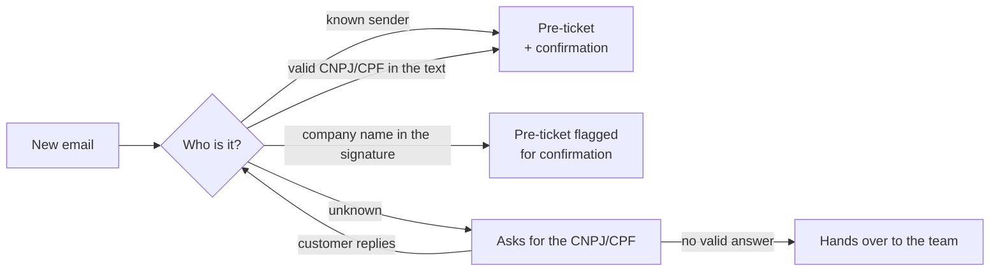

# NOVA

**Automated support-email triage in Python: works out which customer is writing and drafts the ticket for the ERP.**

[](https://github.com/AndrewMBarros/nova/actions/workflows/tests.yml)

[](LICENSE)

**English** · [Português](README.pt-BR.md)

## The problem

In a B2B support inbox, someone has to read every email and work out **which customer sent it**,
which is often unclear: a personal Gmail address, a signature that only says the company name,
a colleague writing for the first time. Then they reply asking for the company's tax ID (CNPJ/CPF in
Brazil), wait, check it, and finally type the ticket into the ERP. It is slow, repetitive and error-prone.

## What NOVA does

NOVA watches the inbox and handles that triage on its own. For each new email it:



1. **Filters** what it should never answer: no-reply senders, auto-replies, duplicates, the team's own
   emails, and conversations that started before it went live.
2. **Identifies the customer**, in order: a group rule (From/Cc), a sender already linked to a customer,
   a valid CNPJ/CPF in the text (check digits verified), or the company name in the signature.
3. **Asks for the tax ID** when it can't tell, explaining exactly what was wrong if the customer sends an
   invalid number, and escalates to the team after a limit or 48h of silence.
4. **Builds the pre-ticket** (customer, contact, type, channel, notes), joining the original request and
   the follow-up into one record, ready to be opened in the ERP.

## Example

```text
From:    João Pereira <joao@alpha.com>
Subject: Internet fora do ar
         Bom dia, estamos sem internet desde as 14h.
```

NOVA doesn't know this sender yet, so it asks for the CNPJ or CPF. The customer replies
`CNPJ: 12.345.678/0001-95`, NOVA validates it and confirms:

```text
Confirmamos o seu cadastro: Empresa Alpha LTDA (12.345.678/0001-95). Estamos providenciando o
atendimento à sua solicitação e em breve um de nossos colaboradores dará continuidade a ela.
```

> *"We have confirmed your registration: Empresa Alpha LTDA. We are arranging your request and one of
> our staff will follow up shortly."* NOVA was built for Brazilian companies, so it talks to customers
> in Portuguese.

The pre-ticket it saves:

```json
{
  "cliente": "Empresa Alpha LTDA",
  "cliente_documento": "12345678000195",
  "contato_nome": "João Pereira",
  "contato_email": "joao@alpha.com",
  "tipo_atendimento": "Suporte Técnico",
  "canal": "E-mail",
  "observacoes": "Assunto: Internet fora do ar\nBom dia, estamos sem internet desde as 14h.\n\nAssunto: RE: Internet fora do ar\nCNPJ: 12.345.678/0001-95"
}
```

Next time `joao@alpha.com` writes, NOVA recognizes him right away and doesn't ask again.

## Design decisions

The interesting part of this project is less the happy path than the cases that would go wrong:

- **Read by date, never by "unread".** In a shared inbox, people open emails before NOVA gets to them.
  NOVA processes everything after a cutoff (`--go-live`) and de-duplicates by `Message-ID`.
- **A company name is a hint, not proof.** Anyone can type a company name in a signature, so a match by
  name creates a pre-ticket flagged `[CONFIRMAR CLIENTE]` and never links the sender's address.
  Two customers with equally specific names count as ambiguous: NOVA asks instead of guessing.
- **Never link a public email domain.** Linking `@gmail.com` to one customer would turn every Gmail
  user into that customer. Only the exact address is learned; whole domains only when explicitly
  registered.
- **Identity is the `From`, not the `Reply-To`.** A known `Reply-To` must not let an unknown sender skip
  the tax ID check.
- **Escalation is not a dead end.** A conversation handed to the team stays open: if the customer
  replies later with the right CNPJ, NOVA validates it normally instead of ignoring them forever.
- **Keep the thread intact.** Replies carry the full `References` chain, otherwise Gmail starts a new
  thread after a few exchanges and NOVA would ask for a CNPJ it already has.
- **Stay out of old conversations.** A reply to a thread NOVA never saw (possibly already handled by a
  person) is ignored, and so is any conversation a team member joins.

Each of these has regression tests. See [`CHANGELOG.md`](CHANGELOG.md) for the full feature list.

## Tech stack

Python 3.10+ · FastAPI · SQLAlchemy (SQLite / PostgreSQL) · IMAP/SMTP and Microsoft Graph (MSAL) ·
pytest (150+ tests) · ruff · GitHub Actions · Docker Compose

## Quick start

```bash
pip install -r requirements-dev.txt
cp .env.example .env          # Windows: copy .env.example .env
uvicorn app.main:app --reload
```

Open http://localhost:8000/docs and send a fake email with `POST /dev/simulate-email`, e.g.
`{"from_email": "cliente@empresa.com", "body": "CNPJ: 12.345.678/0001-95"}`. Then check what NOVA
would reply at `GET /dev/outbox`.

Or with Docker (API + PostgreSQL): `docker compose up --build`. Tests: `pytest`.

> **All data in this repository is fictitious.** The sample customers, CNPJs and email addresses exist
> only for tests and examples.

## Documentation

| | |
|---|---|
| [Configuration](docs/configuration.md) | every `.env` option, the simulated customer base in `data/`, CLI utilities |
| [Gmail (IMAP/SMTP)](docs/guia-gmail.md) | step-by-step setup with a free Gmail account (Portuguese) |
| [Microsoft 365](docs/microsoft365.md) | reading and replying through Microsoft Graph |
| [ERP integration](docs/erp-integration.md) | where to plug a real ERP in |
| [Privacy (LGPD)](docs/privacy.md) | what personal data NOVA stores and how to handle it |

## Project structure

```text
app/
  processor.py     main flow: filters → identify customer → pre-ticket
  worker.py        loop that reads the inbox (IMAP or Graph)
  customers/       customer lookup, contact links, name matching, group rules
  documents/       CNPJ/CPF extraction and validation
  email/           parsing, message templates, sending and reading
  rules/           no-reply, auto-replies, blocklists, states
  database/        SQLAlchemy models and queries
  api/             /health and the /dev simulator
data/              simulated customer base (plain text)
tests/             pytest suite
```

## Roadmap

- Classify the ticket type and urgency from the email text (ML/LLM, with an evaluation set).
- A real ERP integration through a pluggable customer source.
- Alembic migrations and authentication for the admin routes.

## License

[MIT](LICENSE)
