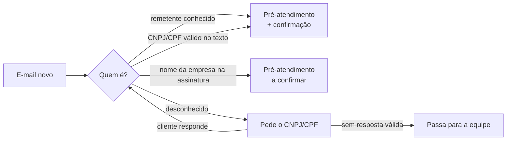

<div align="center">

# NOVA

**Sua caixa de suporte triada antes de alguém abrir.**

A NOVA lê cada e-mail que chega ao suporte, descobre qual cliente escreveu (pelo endereço,
pelo CNPJ/CPF ou pelo nome da empresa) e monta o chamado para o ERP.

[](https://github.com/AndrewMBarros/nova/actions/workflows/tests.yml)


[](https://github.com/astral-sh/ruff)
[](LICENSE)

[English](README.md) · **Português**

[Exemplo](#exemplo) · [Decisões de projeto](#decisões-de-projeto) · [Como rodar](#como-rodar) · [Documentação](#documentação)

</div>

## O problema

Na caixa de suporte de uma empresa B2B, alguém precisa ler cada e-mail e descobrir **de qual cliente
ele é**, o que nem sempre é óbvio: um Gmail pessoal, uma assinatura só com o nome da empresa, um
funcionário escrevendo pela primeira vez. Depois responde pedindo o CNPJ/CPF, espera, confere e só então
digita o chamado no ERP. É lento, repetitivo e sujeito a erro.

## O que a NOVA faz

A NOVA acompanha a caixa e faz essa triagem sozinha:



1. **Filtra** o que nunca deve responder: noreply, respostas automáticas, duplicados, e-mails da própria
   equipe e conversas anteriores à entrada no ar.
2. **Identifica o cliente**, nesta ordem: regra de grupo (De/Cc), remetente já vinculado, CNPJ/CPF válido
   no texto (com os dígitos verificadores conferidos) ou nome da empresa na assinatura.
3. **Pede o documento** quando não sabe quem é, explica o que está errado se o número vier incorreto e
   escala para a equipe depois de um limite de tentativas ou de 48h sem resposta.
4. **Monta o pré-atendimento** (cliente, contato, tipo, canal, observações), juntando o pedido original
   e a resposta num único registro, pronto para virar chamado no ERP.

## Exemplo

`joao@alpha.com` escreve "Bom dia, estamos sem internet desde as 14h." sem se identificar. A NOVA pede o
CNPJ ou CPF; ele responde `CNPJ: 12.345.678/0001-95`; a NOVA confere e confirma:

```text
Confirmamos o seu cadastro: Empresa Alpha LTDA (12.345.678/0001-95). Estamos providenciando o
atendimento à sua solicitação e em breve um de nossos colaboradores dará continuidade a ela.
```

E salva o pré-atendimento com o cliente, o contato e as duas mensagens nas observações. Na próxima vez
que `joao@alpha.com` escrever, a NOVA já o reconhece e não pede o CNPJ de novo. O exemplo completo, com o
JSON salvo, está no [README em inglês](README.md#example).

## Decisões de projeto

- **Lê por data, nunca por "não lido":** numa caixa compartilhada, a equipe abre e-mails antes da NOVA.
- **Nome da empresa é pista, não prova:** identificação só pelo nome gera um pré-atendimento marcado
  `[CONFIRMAR CLIENTE]` e nunca vincula o e-mail. Empate entre dois clientes faz a NOVA perguntar em vez
  de chutar.
- **Nunca vincula domínio público:** vincular `@gmail.com` a um cliente faria todo usuário de Gmail virar
  esse cliente.
- **Identidade é o `From`, não o `Reply-To`.**
- **Escalar não encerra a conversa:** se o cliente responder depois com o CNPJ certo, a NOVA valida
  normalmente.
- **Mantém a thread:** as respostas levam a cadeia completa de `References`, senão o Gmail quebra a
  conversa e a NOVA pediria de novo um CNPJ que já tem.
- **Não se mete em conversa antiga** nem em conversa que alguém da equipe assumiu.

Cada uma tem testes de regressão.

## Tecnologias

Python 3.10+ · FastAPI · SQLAlchemy (SQLite / PostgreSQL) · IMAP/SMTP e Microsoft Graph (MSAL) ·
pytest (150+ testes) · ruff · GitHub Actions · Docker Compose

## Como rodar

```bash
pip install -r requirements-dev.txt
cp .env.example .env          # Windows: copy .env.example .env
uvicorn app.main:app --reload
```

Abra http://localhost:8000/docs e envie um e-mail simulado em `POST /dev/simulate-email`, por exemplo
`{"from_email": "cliente@empresa.com", "body": "CNPJ: 12.345.678/0001-95"}`. A resposta que a NOVA
mandaria aparece em `GET /dev/outbox`. Com Docker: `docker compose up --build`. Testes: `pytest`.

> **Todos os dados deste repositório são fictícios.** Clientes, CNPJs e e-mails de exemplo existem
> apenas para testes.

## Documentação

[Configuração](docs/configuration.md) · [Gmail (IMAP/SMTP)](docs/guia-gmail.md) ·
[Microsoft 365](docs/microsoft365.md) · [Integração com ERP](docs/erp-integration.md) ·
[Privacidade (LGPD)](docs/privacy.md). Os guias estão em inglês, exceto o do Gmail.

## Licença

[MIT](LICENSE)
